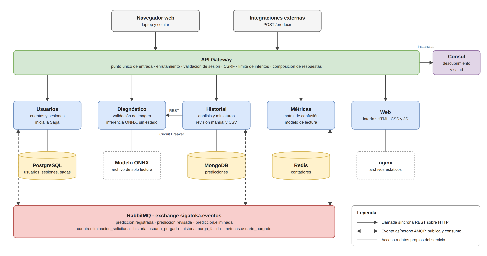

# Detector de Sigatoka negra · Microservicios

[](https://github.com/Ander-Lr/sigatoka-microservicios/actions/workflows/ci.yml)
[](LICENSE)

Aplicación web que diagnostica **Sigatoka negra** (*Pseudocercospora fijiensis*) en hojas de banano a partir de una
foto, construida con una **arquitectura de microservicios**. Es la refactorización de un monolito en FastAPI con
SQLite a cinco servicios independientes, cada uno con su propia base de datos, comunicados por REST y eventos.

El modelo es una red **EfficientNet-B2** exportada a **ONNX**. Responde una de tres clases, `sana`, `sigatoka` u
`otro` (la imagen no es una hoja de banano), en unos 15 ms por imagen en CPU.

> Proyecto académico de Arquitectura de Software. Es una herramienta de apoyo y **no reemplaza el diagnóstico de un
> fitopatólogo**.

## Arquitectura



| Servicio | Responsabilidad | Datos |
|---|---|---|
| `gateway` | Único punto de entrada, validación de sesión, CSRF, límite de intentos y composición de respuestas | ninguno |
| `usuarios` | Cuentas, contraseñas y sesiones. Inicia la Saga de eliminación de cuenta | PostgreSQL |
| `diagnostico` | Validación de la imagen e inferencia del modelo. Sin estado y escalable | modelo ONNX |
| `historial` | Análisis registrados, miniaturas, revisión manual y exportación CSV | MongoDB |
| `metricas` | Matriz de confusión y conteos, alimentados solo por eventos | Redis |
| `web` | Interfaz HTML, CSS y JavaScript | nginx |

**Infraestructura:** Consul para el descubrimiento de servicios y los chequeos de salud, RabbitMQ como broker de
eventos y Docker Compose para la orquestación.

### Patrones aplicados

- **API Gateway** como punto único de entrada. Une el historial y las métricas en una sola respuesta.
- **Base de datos por servicio** con persistencia políglota.
- **Comunicación síncrona** REST cuando quien llama necesita la respuesta, y **asíncrona** con RabbitMQ cuando
  puede continuar sin esperar.
- **Saga coreografiada** para eliminar una cuenta en tres servicios, con compensación si el borrado del historial falla.
- **Circuit Breaker** del gateway hacia cada servicio y de historial hacia diagnóstico. Una dependencia caída no
  arrastra a los demás.
- **Consumidores idempotentes** y cola de mensajes fallidos.
- **Lectura de lo propio escrito:** el gateway espera a que métricas aplique el último evento antes de responder.

Los eventos viajan por el exchange `sigatoka.eventos`:

| Evento | Publica | Consume |
|---|---|---|
| `prediccion.registrada`, `prediccion.revisada`, `prediccion.eliminada` | historial | metricas |
| `cuenta.eliminacion_solicitada` | usuarios | historial |
| `historial.usuario_purgado` | historial | metricas, usuarios |
| `historial.purga_fallida` | historial | usuarios (compensación) |
| `metricas.usuario_purgado` | metricas | usuarios |

## Inicio rápido

Requiere **Docker** con **Docker Compose v2**.

```bash
git clone https://github.com/Ander-Lr/sigatoka-microservicios.git
cd sigatoka-microservicios
cp .env.example .env
docker compose up -d --build
```

O con el script, que además espera a que todo esté sano y abre el navegador:

```bash
./iniciar.sh             # levantar
./iniciar.sh --detener   # detener (los datos se conservan en volúmenes)
```

| Dirección | Qué es |
|---|---|
| http://localhost:8000 | Aplicación web |
| http://localhost:8000/salud | Instancias sanas y estado del circuito de cada servicio |
| http://localhost:8000/gateway/docs | Documentación de la API del gateway |
| http://localhost:8500 | Consul |
| http://localhost:15672 | RabbitMQ (usuario y clave definidos en `.env`) |

El modelo ya viene incluido en `modelo/`, así que no hace falta entrenar.

## Uso

Al abrir la aplicación se crea una cuenta o se inicia sesión. En **Foto** o **Cámara** se analiza una imagen y
después se indica la clase real. **Historial** muestra cada análisis, la matriz de confusión con Sigatoka como clase
positiva (VP, FN, FP, VN) y permite descargar un CSV.

Para integraciones sin cuenta, el análisis sin guardar:

```bash
curl -F "imagen=@hoja.jpg" "http://localhost:8000/predecir?tta=true"
```

```json
{ "clase": "sigatoka", "diagnostico": "Sigatoka negra", "confianza": 0.97, "prob_sigatoka": 0.97,
  "prob_no_hoja": 0.04, "es_hoja_banano": true, "advertencia": null, "distancia_ood": 164.1, "ms": 182.4 }
```

Las peticiones `POST`, `PATCH` y `DELETE` a `/api/*` deben incluir la cabecera `X-Requested-With: fetch`.
La imagen debe ser JPG, PNG o WEBP, de hasta 25 MB y al menos 224 × 224 px.

## Demostración de los patrones

```bash
# Escalar solo la inferencia: Consul reparte la carga entre las tres instancias
docker compose up -d --scale diagnostico=3

# Circuit Breaker: los análisis fallan al instante y el historial sigue funcionando
docker compose stop diagnostico
docker compose start diagnostico        # el circuito se cierra solo tras la llamada de prueba

# Compensación de la Saga: "Eliminar cuenta" termina compensada y la cuenta se reactiva
SIMULAR_FALLO_PURGA=1 docker compose up -d historial
```

## Pruebas

```bash
./scripts/prueba_humo.sh
```

Recorre registro, análisis, revisión, métricas, CSV y la Saga contra el sistema levantado. GitHub Actions ejecuta
el análisis estático con Ruff y esta misma prueba en cada push.

## Configuración

Todas las variables están en `.env.example`. Las credenciales que trae son **solo para desarrollo local** y deben
cambiarse en cualquier otro entorno.

| Variable | Uso |
|---|---|
| `PUERTO` | Puerto público del gateway |
| `POSTGRES_USER`, `POSTGRES_PASSWORD` | Base de datos de usuarios |
| `MONGO_USER`, `MONGO_PASSWORD` | Base de datos del historial |
| `REDIS_PASSWORD` | Base de datos de métricas |
| `RABBITMQ_USER`, `RABBITMQ_PASSWORD` | Broker de mensajería |
| `SIGATOKA_MAX_MB` | Tamaño máximo de imagen |
| `SIMULAR_FALLO_PURGA` | `1` hace fallar el borrado del historial para demostrar la compensación |

## Estructura

```
├── docker-compose.yml        servicios, bases de datos, Consul y RabbitMQ
├── iniciar.sh                levanta y detiene el sistema
├── servicios/
│   ├── comun/                descubrimiento, Circuit Breaker y mensajería compartidos
│   ├── gateway/              API Gateway
│   ├── usuarios/             cuentas y sesiones
│   ├── diagnostico/          inferencia ONNX
│   ├── historial/            análisis registrados
│   ├── metricas/             matriz de confusión
│   └── web/                  interfaz y configuración de nginx
├── modelo/                   modelo ONNX, detector de imágenes ajenas y metadatos
├── infra/consul/             registro del servicio web en Consul
├── scripts/prueba_humo.sh    prueba de punta a punta
└── docs/                     diagrama de arquitectura (PNG y draw.io)
```

## Limitaciones

- El modelo se entrenó con fotos de un solo dataset de Tanzania. Su desempeño en otras regiones, variedades o
  cámaras debe validarse con fotos propias, y no distingue otras enfermedades del banano.
- Los eventos se publican después de guardar, sin el patrón Transactional Outbox.
- Gateway, Consul y RabbitMQ corren como instancias únicas. Para producción se requieren réplicas, HTTPS y
  autenticación entre servicios.
- Los navegadores solo permiten la cámara en `localhost` o con HTTPS. Desde otro dispositivo use el modo Foto.

## Licencia y créditos

- Código bajo licencia [MIT](LICENSE).
- Dataset de entrenamiento: N. Mduma y C. Elinisa, *Banana Leaves Imagery Dataset*, Scientific Data 12, 477 (2025),
  [doi:10.1038/s41597-025-04456-4](https://doi.org/10.1038/s41597-025-04456-4). Las imágenes no se distribuyen
  en este repositorio.
- Modelo base preentrenado de [timm](https://github.com/huggingface/pytorch-image-models).
